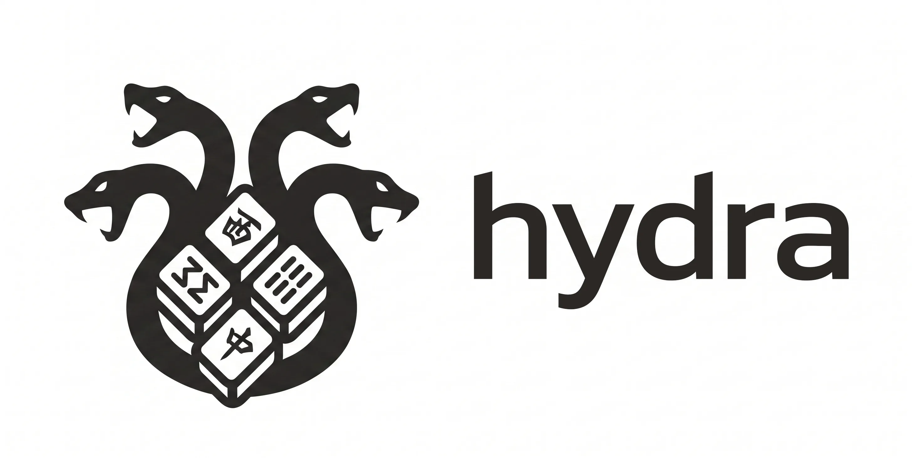
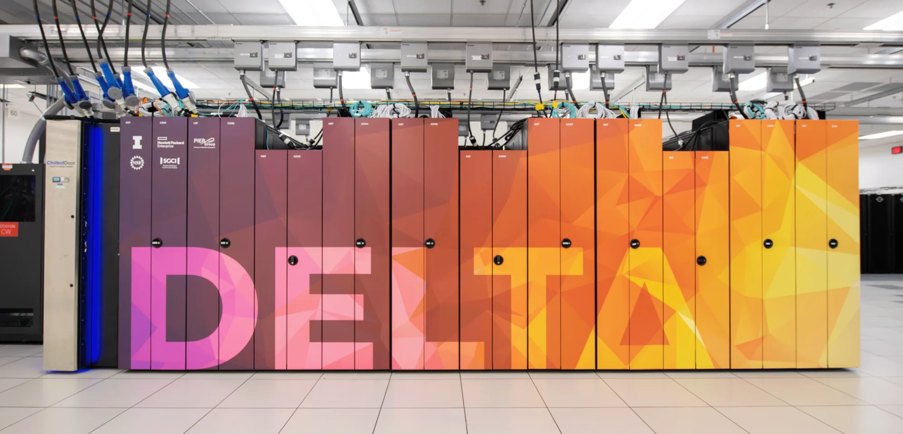

<p align="center">

</p>

<h1 align="center">Hydra v3</h1>

<p align="center">An attempt at making Mahjong reinforcement learning as fast as possible.</p>

Hydra v3 trains a PyTorch tile-edit Transformer on four-player red-five hanchan self-play. Rollout and paired-evaluation rules run in MahJax; the Rust arena remains a separate reference implementation. No trained weights or model-strength claim are included.

## Quick start

```sh
pixi run build        # native reference extension
pixi run test         # rebuilds it, then runs the suite
pixi run typecheck && pixi run lint
pixi run agent --help
```

Requires Pixi 0.84.2+, Git 2.49+ and stable Rust; on x86-64 Linux also Clang, mold and sccache on `PATH`. PPO and paired evaluation default to CUDA, and `--device cpu` is available for diagnostics.

## Repo map

- `python/hydra3/` — actor graph, PPO learner, collector, evaluation, checkpoints
- `native/` — Rust arena, exposed as `hydra3._arena`
- `vendor/mahjax/` — pinned rules engine, worked on in-tree
- `tests/` — suite plus the pinned engine parity trace
- `benchmarks/mahjax/` — recorded RTX 5070 runs

## Notes

Engine pinning, parity checking, telemetry and the RTX 5070 throughput record live in [`docs/NOTES.md`](docs/NOTES.md).

## Compute support

<p align="center">

</p>

Hydra v3 remains sponsored with compute support from Delta advanced computing and data resources, supported by the National Science Foundation (award OAC 2005572) and the State of Illinois. Delta is a joint effort of the University of Illinois Urbana-Champaign and its National Center for Supercomputing Applications.
